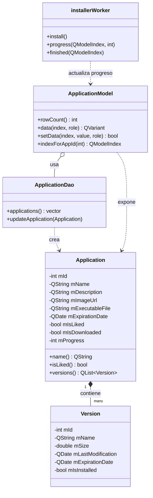
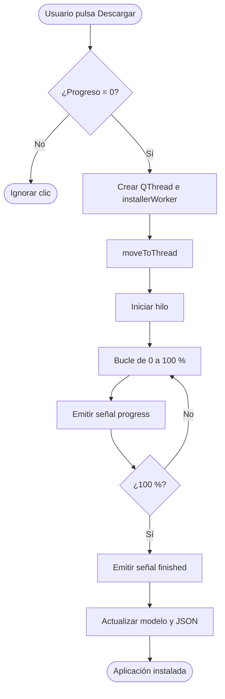
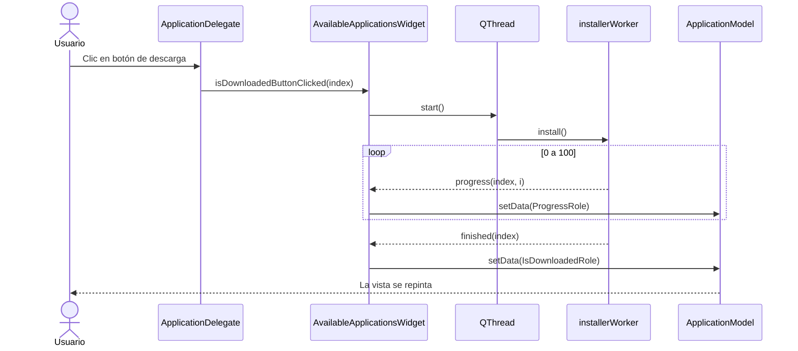
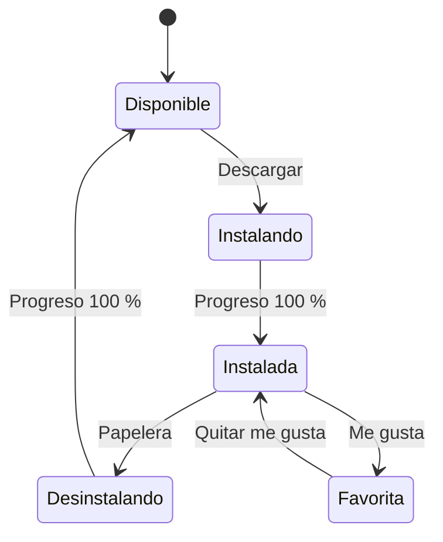
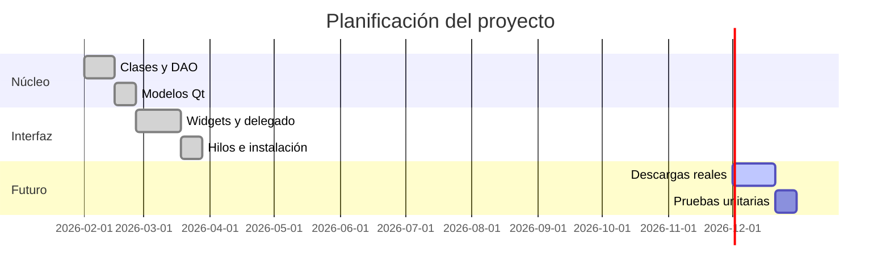

<!--
  README de la actividad AE01_07 - Markdown
  Proyecto: AeApplicationManager (C++ / Qt)
  Autor: Alejandro Rodríguez
  Nota: las fórmulas, la planificación y algunos datos de contexto son inventados
  para cubrir todos los elementos que pide la actividad.
-->

[//]: # (Comentario de Markdown: este bloque no se muestra al visualizar el documento)

<a id="indice"></a>

<div align="center">


<h1>🗂️ AeApplicationManager</h1>

<p><b>Gestor de aplicaciones de escritorio</b> desarrollado en <b>C++</b> con <b>Qt</b></p>


</div>

---

## 📑 Índice

1. [📌 Introducción](#introduccion)
2. [🧰 Tecnologías y requisitos](#tecnologias)
3. [🏗️ Arquitectura del proyecto](#arquitectura)
4. [✨ Funcionalidades](#funcionalidades)
5. [🚀 Instalación y uso](#instalacion)
6. [📐 Modelo de datos y fórmulas](#modelo-datos)
7. [🗓️ Planificación y tareas](#planificacion)
8. [🖼️ Galería y recursos](#galeria)
9. [🏁 Conclusiones y créditos](#conclusiones)

---

<a id="introduccion"></a>

# 📌 Introducción [⬆️](#indice "Volver al índice")

**AeApplicationManager** es una aplicación de escritorio que permite *descubrir, instalar, desinstalar y marcar como favoritas* un conjunto de aplicaciones, de forma parecida a una pequeña tienda de software.\
El proyecto forma parte del repositorio [AeProyectos_cpp_Qt](https://github.com/AlejandroRodriguez05/AeProyectos_cpp_Qt "Repositorio completo en GitHub"), que agrupa varios proyectos en C++ con Qt.

La aplicación está dividida en dos módulos: una **librería** (`application-core`) con la lógica y los datos, y una **interfaz gráfica** (`application-desktop`) que los muestra al usuario.<br>
Esta separación permite reutilizar el núcleo sin depender de la interfaz.

## 🎯 Objetivos

- Practicar la arquitectura **Model/View** de Qt.
- Separar la lógica de negocio de la interfaz gráfica.
- Simular tareas largas (instalación) sin bloquear la interfaz usando **hilos**.
  - Cada instalación se ejecuta en su propio `QThread`.
  - La interfaz solo recibe señales de progreso.

## 🔤 Formatos de texto utilizados

Este documento utiliza **negrita**, *cursiva*, ***negrita cursiva***, ~~tachado~~ y `código en línea`.

La versión ~~1.0.0~~ de la documentación fue sustituida por esta versión ***definitiva***.

> [!NOTE]
> Este README forma parte de la actividad **AE01_07** de Markdown. Algunos apartados (fórmulas, planificación y roadmap) se han inventado para completar los elementos que exige la tarea.

---

<a id="tecnologias"></a>

# 🧰 Tecnologías y requisitos [⬆️](#indice "Volver al índice")

El proyecto se ha construido con las siguientes herramientas:

| Tecnología |   Versión   | Uso en el proyecto                    |
| :--------- | :---------: | ------------------------------------: |
| C++        |     17      | Lenguaje principal                    |
| Qt Widgets |      6      | Interfaz gráfica de escritorio        |
| qmake      |      Qt     | Sistema de compilación (`.pro`)       |
| JSON       |      —      | Almacenamiento de las aplicaciones    |
| QSS        |      —      | Hoja de estilos de la interfaz        |

## 📋 Requisitos previos

1. **Qt 6** con el módulo *Widgets* instalado.
2. Un compilador compatible con **C++17**:
   1. MSVC (Visual Studio) en Windows.
   2. MinGW o GCC, si se adapta la ruta del JSON.
3. **Qt Creator** (opcional, pero recomendado).

> [!TIP]
> Abre directamente el archivo [`aeapplicationmanager.pro`](aeapplicationmanager.pro "Proyecto raíz de qmake") desde Qt Creator: compilará primero la librería y después la aplicación.

---

<a id="arquitectura"></a>

# 🏗️ Arquitectura del proyecto [⬆️](#indice "Volver al índice")

## 📁 Estructura de carpetas

```text
AeApplicationManager/
├── aeapplicationmanager.pro        # Proyecto raíz (subdirs)
├── application-core/               # Librería con la lógica
│   ├── application.h/.cpp
│   ├── version.h/.cpp
│   ├── applicationdao.h/.cpp
│   ├── applicationmodel.h/.cpp
│   ├── versionmodel.h/.cpp
│   └── installerworker.h/.cpp
└── application-desktop/            # Interfaz gráfica
    ├── main.cpp, mainwindow.*
    ├── applicationmanagerwidget.*
    ├── availableapplicationswidget.*
    ├── installedapplicationswidget.*
    ├── applicationinfodialog.*
    ├── applicationdelegate.*
    ├── filterproxymodel.*
    ├── searchwidget.*
    ├── styles.qss
    └── Resources/applications.json
```

## 🧩 Diagrama de clases (núcleo)



## 🔄 Flujo de una instalación



## 📡 Secuencia de señales y slots



## 🔁 Estados de una aplicación



> [!IMPORTANT]
> Los **tres elementos** clave del patrón Model/View son: el modelo (`ApplicationModel`), la vista (`QListView`) y el delegado (`ApplicationDelegate`), que dibuja cada tarjeta de aplicación.

---

<a id="funcionalidades"></a>

# ✨ Funcionalidades [⬆️](#indice "Volver al índice")

## 🛒 Gestión de aplicaciones

- 📥 **Descargar / instalar** aplicaciones con barra de progreso.
- 🗑️ **Desinstalar** aplicaciones instaladas.
- ❤️ **Marcar favoritas** con el icono del corazón.
- ℹ️ **Ver información** detallada de cada aplicación:
  - Descripción y fecha de caducidad.
  - Lista de versiones con tamaño y fecha de modificación.
  - Instalación o desinstalación por versión.

## 🔍 Búsqueda y filtros

1. Buscar por nombre desde el cuadro de texto superior.
2. Filtrar por **Instaladas** o **Favoritas**.
3. Cambiar entre vista de **cuadrícula** y vista de **menú**.
   - La vista de cuadrícula usa el icono <kbd>grid</kbd>.
   - La vista de menú usa el icono <kbd>menu</kbd>.

## 🔔 Bandeja del sistema

La aplicación no se cierra al pulsar la <kbd>X</kbd>: se **oculta** en el área de notificación.\
Con *doble clic* sobre el icono se restaura la ventana y con el menú contextual (**Salir**) se cierra definitivamente.

<details>
<summary>👀 Ver detalles técnicos de la bandeja del sistema</summary>

<br>

- Se usa `QSystemTrayIcon` con el logo de la aplicación.
- El método `closeEvent` ignora el evento y llama a `hide()`.
- Se desactiva `quitOnLastWindowClosed` para que el proceso siga vivo.

</details>

> [!WARNING]
> Si la ventana está oculta y no se usa el menú **Salir**, el proceso seguirá ejecutándose en segundo plano.

---

<a id="instalacion"></a>

# 🚀 Instalación y uso [⬆️](#indice "Volver al índice")

## ⬇️ Clonar el repositorio

```bash
git clone https://github.com/AlejandroRodriguez05/AeProyectos_cpp_Qt.git
cd AeProyectos_cpp_Qt/AeApplicationManager
```

## 🔨 Compilar

Desde Qt Creator basta con abrir el archivo `.pro` y pulsar **Ejecutar**. Desde la terminal:

```bash
qmake aeapplicationmanager.pro
nmake        # o mingw32-make / make según tu compilador
```

El archivo de proyecto raíz define los dos módulos y la dependencia entre ellos:

```qmake
TEMPLATE = subdirs

SUBDIRS += \
    application-core \
    application-desktop

application-desktop.depends = application-core
```

## 💻 Fragmento de código: simulación de la instalación

El trabajador simula el progreso con un tiempo aleatorio por paso:

```cpp
void installerWorker::install()
{
    quint32 tiempo = QRandomGenerator::global()->bounded(50, 101);

    for (int i = 0; i <= 100; i++) {
        QThread::msleep(tiempo);
        emit progress(mSourceIndex, i);
    }
    emit finished(mSourceIndex);
}
```

## 🧾 Formato de los datos

Las aplicaciones se cargan desde [`applications.json`](application-desktop/Resources/applications.json "Datos de las aplicaciones"):

```json
{
    "id": 1,
    "name": "Cloud",
    "executable_file": "Cloud.exe",
    "expiration_date": "2026-11-11",
    "is_liked": true,
    "is_downloaded": true,
    "versions": [
        { "id": 2, "name": "1.1.0", "size": 1.1, "is_installed": true }
    ]
}
```

## 🎨 Estilos

La apariencia se define en [`styles.qss`](application-desktop/styles.qss "Hoja de estilos de Qt"), por ejemplo el fondo de la lista:

```css
QListView {
    background-color: #454545;
    border: none;
    padding: 10px;
}
```

> [!CAUTION]
> La ruta del JSON (`../Resources/applications.json`) es **relativa** al directorio de ejecución. Si ejecutas la aplicación desde otra carpeta, no encontrará el archivo.

---

<a id="modelo-datos"></a>

# 📐 Modelo de datos y fórmulas [⬆️](#indice "Volver al índice")

## 📊 Aplicaciones incluidas

| Id | Aplicación | Ejecutable  | Caduca     | Versiones |  Tamaño más reciente (MB) |
| -: | :--------- | :---------- | :--------: | :-------: | ------------------------: |
|  1 | Cloud      | `Cloud.exe`  | 2026-11-11 |     2     |                       1.1 |
|  2 | aeMaps     | `Maps.exe`   | 2027-12-15 |     2     |                       1.1 |
|  3 | Scann      | `Scann.exe`  | 2026-12-01 |     2     |                       1.1 |
|  4 | aeSync     | `Sync.exe`   | 2027-03-18 |     2     |                       1.1 |
|  5 | aeTools    | `Tools.exe`  | 2027-05-09 |     2     |                       1.1 |
|  6 | aeViewer   | `Viewer.exe` | 2027-08-21 |     3     |                       3.3 |

## 🧮 Fórmulas matemáticas

### Tiempo de instalación

El bucle del trabajador realiza 101 pasos (de 0 a 100) y cada paso espera $\tau$ milisegundos, con $\tau \in \{50, \dots, 100\}$. El tiempo total es:

$$
T = 101 \cdot \tau \quad \Rightarrow \quad T_{\min} = 5{,}05\ \text{s}, \quad T_{\max} = 10{,}1\ \text{s}
$$

Como $\tau$ se elige de forma uniforme, su valor esperado es $E[\tau] = \frac{50 + 100}{2} = 75\ \text{ms}$ y, por tanto, $E[T] = 7{,}575\ \text{s}$.

### Tamaño total de las versiones instaladas

Si $s_i$ es el tamaño de la versión $i$ y $n$ el número de versiones instaladas:

$$
S_{\text{total}} = \sum_{i=1}^{n} s_i
$$

Con las cinco primeras aplicaciones (una versión instalada de $1{,}1$ MB cada una) se obtiene $S_{\text{total}} = 5 \times 1{,}1 = 5{,}5$ MB.

### Porcentaje de aplicaciones instaladas

$$
P = \frac{N_{\text{instaladas}}}{N_{\text{totales}}} \times 100 = \frac{5}{6} \times 100 \approx 83{,}3\ \%
$$

### Velocidad media de descarga (inventada)

Para una versión de tamaño $s$ (MB) descargada en $T$ segundos, la velocidad es $v = \dfrac{s}{T}$. Con $s = 3{,}3$ MB y $T = E[T] = 7{,}575$ s resulta $v \approx 0{,}44\ \text{MB/s}$.

### Complejidad del filtrado (inventada)

Cada vez que cambia el texto de búsqueda se llama a `filterAcceptsRow` una vez por aplicación, por lo que el coste es lineal: $O(N)$. Si además se ordena la lista, el coste pasa a ser $O(N \log N)$.

## ⏳ Cuenta atrás de caducidad

Los días restantes de una aplicación se calculan como $d = f_{\text{caducidad}} - f_{\text{hoy}}$ y se pueden obtener con `QDate::daysTo()`:

```cpp
int diasRestantes = QDate::currentDate().daysTo(application.expirationDate());
```

---

<a id="planificacion"></a>

# 🗓️ Planificación y tareas [⬆️](#indice "Volver al índice")

## ✅ Lista de tareas

- [x] Separar el proyecto en librería (`application-core`) y GUI (`application-desktop`)
- [x] Cargar las aplicaciones desde un archivo JSON
- [x] Mostrar las aplicaciones con un delegado personalizado
- [x] Instalar y desinstalar con hilos y barra de progreso
- [x] Filtrar por texto, instaladas y favoritas
- [x] Icono en la bandeja del sistema
- [ ] Descargas reales desde un servidor
- [ ] Guardar la configuración del usuario
- [ ] Soporte para Linux y macOS
  - [ ] Ruta del JSON independiente del directorio de ejecución
  - [ ] Pruebas en otros compiladores
- [ ] Añadir pruebas unitarias del modelo

## 📅 Diagrama de Gantt (inventado)



---

<a id="galeria"></a>

# 🖼️ Galería y recursos [⬆️](#indice "Volver al índice")


| Qt | C++ |
| :-: | :-: |
|  |  |


## 💾 Imágenes locales del proyecto

Iconos de las aplicaciones incluidas (carpeta [`application-desktop/apps`](application-desktop/apps "Carpeta con los iconos")):

<table>
  <tr align="center">
    <td><br><b>Cloud</b></td>
    <td><br><b>aeMaps</b></td>
    <td><br><b>Scann</b></td>
  </tr>
  <tr align="center">
    <td><br><b>aeSync</b></td>
    <td><br><b>aeTools</b></td>
    <td><br><b>aeViewer</b></td>
  </tr>
</table>

Iconos de la interfaz:    

## 🔗 Enlaces a archivos del proyecto

| Archivo | Descripción |
| :------ | :---------- |
| [`application.h`](application-core/application.h "Clase Application") | Entidad que representa una aplicación |
| [`version.h`](application-core/version.h "Clase Version") | Entidad que representa una versión |
| [`applicationmodel.cpp`](application-core/applicationmodel.cpp "Modelo de lista") | Modelo Qt que expone las aplicaciones |
| [`filterproxymodel.cpp`](application-desktop/filterproxymodel.cpp "Modelo proxy") | Filtros por texto, instaladas y favoritas |
| [`applicationdelegate.cpp`](application-desktop/applicationdelegate.cpp "Delegado") | Dibujo de las tarjetas de la lista |

## 💬 Citas relacionadas

> “Any fool can write code that a computer can understand. Good programmers write code that humans can understand.”
>
> — **Martin Fowler**, *Refactoring*

> “Within C++, there is a much smaller and cleaner language struggling to get out.”
>
> — **Bjarne Stroustrup**, creador de C++

> “Talk is cheap. Show me the code.”
>
> — **Linus Torvalds**

---

<a id="conclusiones"></a>

# 🏁 Conclusiones y créditos [⬆️](#indice "Volver al índice")

Con este proyecto se han aplicado conceptos importantes de **Qt** y **C++ moderno**: arquitectura *Model/View*, delegados personalizados, modelos *proxy*, lectura de JSON y programación con **hilos**.\
Queda como mejora futura conectar la aplicación con descargas reales y ampliar la compatibilidad con otros sistemas operativos.

## 👤 Autor

- **Alejandro Rodríguez** · [@AlejandroRodriguez05](https://github.com/AlejandroRodriguez05 "Perfil de GitHub")

## 📚 Recursos consultados

- [Documentación de Qt](https://doc.qt.io/ "Documentación oficial de Qt")
- [Guía de Markdown de GitHub](https://docs.github.com/es/get-started/writing-on-github "Escribir en GitHub")
- [Mermaid](https://mermaid.js.org/ "Documentación de Mermaid")

<p align="center">
  <sub>AE01_11 · Markdown</sub>
</p>

[⬆️ Volver al índice](#indice "Ir al índice")
